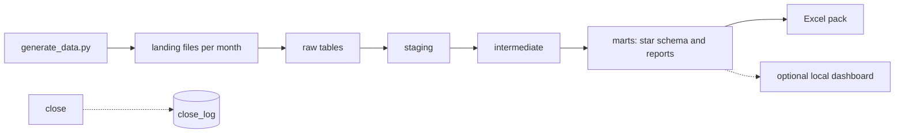
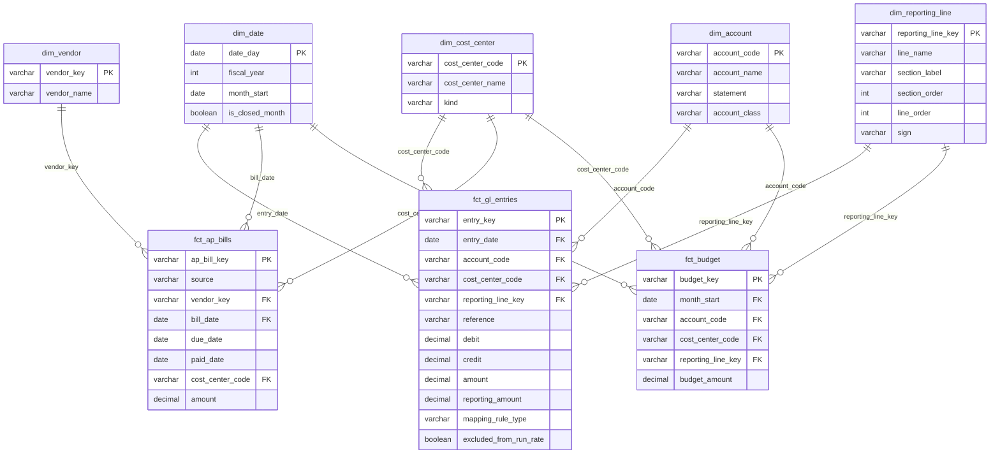

# finance-analytics-warehouse

## What it is

A small finance data warehouse that runs a monthly close. A seeded Python script invents a fictional five-store outdoor-gear retailer, Larkspur Outfitters, and writes a ledger export and two payables exports for each month. All of the data is synthetic and every amount is in NIU (normalized index units). A close script loads each month into a database, runs SQL transformations and tests, re-checks the totals a second way, builds an Excel management pack and writes a log row. The analysis below is what comes out of that system.

Results from a full run, January 2024 to the first days of October 2026:

- 34 monthly closes, each passing 116 checks.
- Adding the two payables exports overstates what is owed by 82 percent. Matching removes the double count: 13.32 million NIU becomes 7.33 million.
- A year-end stock-count journal of 171,800 NIU makes shrinkage look 76 percent higher than it is. Leaving it out of the run rate shows shrinkage almost flat, down 0.6 percent.
- Budget against actual flags 21 quarterly misses. They trace to one store's wages, one store's sales, head office delivery costs, the year-end stock count and one mis-posted fee.
- Payments slowed from July 2025. Bills paid after their due date went from about 2 percent to 82 percent.

## The problem

Finance data rarely arrives as a clean table. This project handles four ordinary messes.

- The ledger export is a report. It has title rows, one block per account, repeated column headings and subtotal rows.
- A year-end journal puts a large amount into one month. A plain average then makes a normal month look like a spike.
- The last month in the data is only a few days old. Averaging it with full months understates everything.
- The bill-pay platform and the accounting system both record the same supplier bills. Adding the two exports counts most bills twice.

## How it works

Three tools do the work. DuckDB is a database that lives in one file, so there is nothing to install or host. dbt runs SQL files in order, so every transformation is a readable query and every rule can have a test. A star schema is a way to lay out a database: tables of events (facts, such as one ledger posting) surround small lookup tables (dimensions, such as accounts and cost centres).



Python reads files and runs the steps in order. SQL holds every business rule. They meet in two places: the `raw` tables Python writes and the `marts` tables everything else reads.

| Layer | What it holds |
|---|---|
| landing | One folder per month with the ledger `.xlsx`, the platform bills `.csv` and the accounting bill lines `.csv`. One budget file. |
| raw | The files as loaded, plus the month they arrived in. Loading a month again replaces it. |
| staging | One model per raw table: types, names, a row key, tidied vendor names. |
| intermediate | The rules: which reporting line a ledger row belongs to, which months are closed, which bills match which documents. |
| marts | The star schema and the report tables. |

A CSV file (`dbt/seeds/mapping_rules.csv`) holds the rules that place a ledger row on a reporting line: a reference override first, then the account code, then a keyword in the description. The first rule that matches wins, and the row keeps the rule that fired. The journals to leave out of the run rate are also a CSV file. Changing a rule is a data change, not a code change.

The dbt project has 27 models and 5 seeds: 4 staging models, 5 intermediate models, 5 dimensions (`dim_date`, `dim_account`, `dim_cost_center`, `dim_reporting_line`, `dim_vendor`), 3 facts (`fct_gl_entries`, `fct_ap_bills`, `fct_budget`) and 10 reports (`rpt_monthly_pl`, `rpt_store_pl`, `rpt_budget_vs_actual`, `rpt_budget_misses`, `rpt_run_rate`, `rpt_variance`, `rpt_ap_reconciliation`, `rpt_ap_totals`, `rpt_ap_aging`, `rpt_dpo`).



## The monthly close

`python -m src.close --month 2026-09` closes one month:

1. Load that month's files into the raw tables. The load deletes the month's rows and inserts them again, so running it twice never doubles anything.
2. Run `dbt build`: all models and all tests.
3. Re-read the raw ledger file with a separate checker and compare it with the marts.
4. Build the Excel pack and evaluate every formula in it. The pack has a P&L by month with live `SUM` formulas, a store P&L, budget against actual, run rate and variance, and payables (reconciliation, aging and days payable outstanding).
5. Append a row to the `close_log` table. If anything failed, including a crash inside a check, the row says so and the command exits with an error.

`python -m src.run_all` generates the data and closes all 34 months in order, from January 2024 to the first days of October 2026. Four rows of the log from a full run:

| Month | Ledger rows | Platform bills | Bill lines | Budget rows | Checks passed | Status |
|---|---|---|---|---|---|---|
| 2024-01 | 388 | 35 | 71 | 2,136 | 116 of 116 | closed |
| 2025-12 | 398 | 36 | 73 | 2,136 | 116 of 116 | closed |
| 2026-09 | 388 | 34 | 81 | 2,136 | 116 of 116 | closed |
| 2026-10 (partial) | 62 | 3 | 6 | 2,136 | 116 of 116 | closed |

All 34 months closed. Together they loaded 12,894 ledger rows, 1,170 platform bills and 2,548 bill lines. Each close runs 116 checks: 111 dbt data tests, 2 dbt unit tests, the load, the separate check and the formula check.

## Findings

The data was generated with five planted problems. The system finds them from the data and the rule files. None is hard-coded in the SQL.

### 1. The December count adjustment

Each December a journal books the year's physical stock-count shrinkage into cost of goods in one go. It stays in the monthly P&L but is on the excluded list, so the run rate leaves it out.

| | Amount (NIU) |
|---|---|
| December 2024 journal | 64,300 |
| December 2025 journal | 171,800 |
| Inventory shrinkage per month, run rate without the journal | 6,398 |
| Same, with the journal left in | 20,715 |
| Operating income per month, run rate without the journal | 60,898 |
| Same, with the journal left in | 46,581 |

The run rate is the average month over the last 12 closed months (October 2025 to September 2026). Compared with the 12 months before, shrinkage changed by -0.6 percent without the journal. With the journal left in it looks 76 percent higher, and the variance report flags it.

### 2. The partial month

October 2026 has 62 ledger rows and its last posting is on 4 October. A month counts as closed when it has a posting on its last day. October fails that test, so it stays out of every run-rate window and every quarterly budget comparison. It remains in the monthly P&L, marked partial.

### 3. The payables double count

| | Amount (NIU) |
|---|---|
| Platform bills | 6,812,274 |
| Accounting bill lines | 6,511,913 |
| Naive total | 13,324,187 |
| Less platform bills matched to a document (1,042 bills) | 5,974,856 |
| Less ambiguous bills held out (33 bills) | 19,589 |
| De-duplicated total | 7,329,743 |

The naive total is 82 percent too high. A platform bill matches a document when the vendor name is the same after tidying, the amounts are within 0.50 and the dates are within 3 days. Of the 1,170 platform bills, 1,042 matched one document, 95 were never synced and 33 are held out as ambiguous (two candidate documents, or a document that two platform bills both claim). A further 209 documents were entered directly in the accounting system. The platform leaves the GL code blank on many bills, and 587 matched bills took their code from the document.

### 4. Budget against actual

The budget covers FY2025 and FY2026 by account, cost centre and month. A quarterly miss is a line and cost centre that is worse than budget by more than 10 percent and by more than 3,000 NIU, with all three months closed. The close flagged 21 of 626 combinations of line, cost centre and quarter.

| What | Quarters | Example (NIU) |
|---|---|---|
| ST03 store wages over budget | 5, from Q3 2025 | Q3 2025: budget 44,160, actual 49,615 (12 percent over) |
| ST04 sales under budget (apparel, equipment, footwear) | 3 each, all of FY2026 so far | Apparel, Q3 2026: budget 122,261, actual 102,528 (16 percent under) |
| Outbound freight at head office over budget | 1 (Q4 2025) | Budget 17,710, actual 24,884 (41 percent over) |
| Inventory shrinkage over budget at all five stores | 1 each (Q4 2025) | The December count adjustment was larger than the budgeted one |
| Professional fees at head office over budget | 1 (Q2 2025) | A lease-review legal fee was posted to the wrong account. A reference rule moves it to the right line. |

### 5. Slower payment and days payable outstanding

Days payable outstanding (DPO) is how many days of purchases are still unpaid at month end. Here it is open payables divided by the bills dated in the last 90 days, times 90. Payment timing was planted to slip from July 2025.

| Period | Average DPO (days) | Days from bill to payment | Bills paid after the due date |
|---|---|---|---|
| Mar to Dec 2024 | 33.8 | 37.3 | 2 percent |
| Jan to Jun 2025 | 40.6 | 36.7 | 3 percent |
| Jul to Dec 2025 | 41.5 | 42.0 | 53 percent |
| Jan to Sep 2026 | 47.4 | 46.7 | 82 percent |

January and February 2024 are left out because bills dated before January 2024 are not in the data, so open payables are understated in those two months. Monthly DPO is noisy because a few large inventory bills dominate, so the days from bill to payment is the steadier signal. Both rise. At 30 September 2026, 8 bills (39,012 NIU) were 1 to 30 days past due. At 30 June 2025 none was past due.

### Gross margin by store

Last 12 closed months. The head office row carries online sales.

| Cost centre | Revenue (NIU) | Gross margin (NIU) | Gross margin |
|---|---|---|---|
| ST01 | 1,553,667 | 819,483 | 53 percent |
| ST02 | 1,335,496 | 712,236 | 53 percent |
| ST03 | 1,178,159 | 635,883 | 54 percent |
| ST04 | 916,630 | 490,740 | 54 percent |
| ST05 | 1,235,690 | 664,774 | 54 percent |
| HQ01 | 1,201,623 | 686,692 | 57 percent |

The 6,381 profit and loss rows were placed by 6,351 account rules, 28 keyword rules and 2 reference overrides. No row was left unmapped.

## The checks

- dbt tests (111 data tests and 2 unit tests). Keys are unique and not null, and every fact key exists in its dimension. Accepted values are enforced. Custom tests cover the rest: every profit and loss row is mapped exactly once, marts totals equal staging totals for every month, and de-duplicated payables equal the naive total less matched less held out. Closed months are re-derived from the raw postings, no partial month sits in a run-rate window, and excluded journals are out of the run rate but still in the monthly P&L. Budget against actual ties to both the ledger and the budget file.
- Separate check (`src/verify.py`). It re-reads the raw `.xlsx` file with its own small reader and compares the row count and the total per account with the marts. It imports nothing from the rest of the code, and a test enforces that.
- Formula check. It opens the Excel pack, evaluates every formula with a small evaluator (`SUM`, plus and minus) and compares each result with a value computed in Python. A formula it cannot evaluate counts as a failure.
- pytest. It covers the parser, the loader (loading a month again does not double rows), the close log, the separate check, the formula evaluator, generator determinism, and end-to-end closes with the real dbt.

## Run it

You need Python 3.11 or newer. CI runs the steps below on 3.11, 3.12 and 3.13.

```
python -m venv .venv
source .venv/bin/activate
pip install -r requirements.txt pytest "ruff>=0.6,<1"
python -m src.run_all        # generate the data and close every month, about two minutes
pytest -q
ruff check .
```

Open `warehouse/larkspur.duckdb` with any DuckDB client to query the marts, or open a pack from `output/`. The dbt project is in `dbt/` and can run alone with `LARKSPUR_DB=warehouse/larkspur.duckdb dbt build --project-dir dbt --profiles-dir dbt`.

### Optional: a local dashboard

`dashboard/` is an Evidence.dev project (a tool that turns SQL and Markdown into charts) that reads the warehouse file. It has pages for the overview, stores, budget against actual, payables and the close log. It needs Node 22 or newer (`.nvmrc` pins the version used) and a warehouse built by the steps above.

```
cd dashboard
npm install
npm run dev
```

`npm run build` writes a static copy to `dashboard/build`. The dashboard is for local use. It is not part of the close and is not published anywhere.

## Scope and limits

- Everything is synthetic. I wrote the generator, so the findings show that the system detects the problems I planted. Real ledgers will differ.
- One company, one unit of account (NIU), three years, five stores and a head office. There is no balance sheet reporting, cash flow or tax.
- Run rates are monthly averages over closed months. There is no weekly view.
- Payment dates are the ones known at the last run. A payment after 4 October 2026 shows as unpaid.
- Matching cannot catch a synced bill whose accounting date drifted more than 3 days. The generator plants a few, and they still count twice.
- The accounting system's payables and the ledger are generated separately, so payables do not tie to a ledger liability account.
- DPO uses all bills as purchases, because the payables include expense bills as well as stock. January and February 2024 are warm-up months.
- A partial month is logged as closed because the close ran. The data itself marks it partial, and every report treats it that way.
- The close is a batch job run by hand or on a schedule, not an orchestrated service.

MIT licensed.
