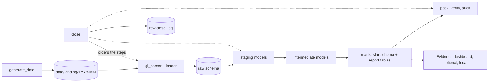
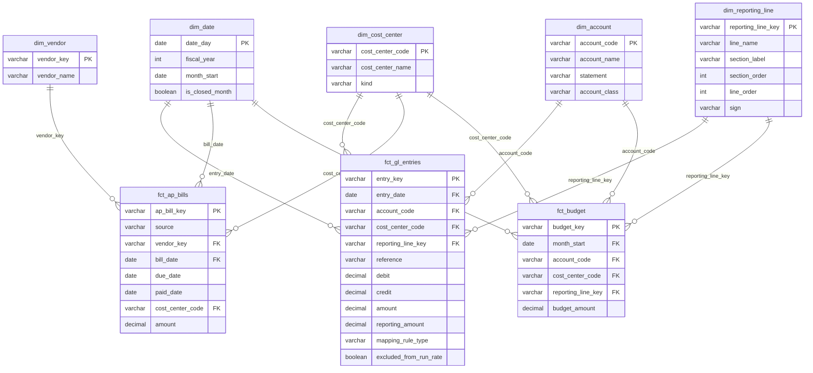

# Design

All data is synthetic and generated by `src/generate_data.py`. Amounts are in NIU (normalized index units). This page
lists the modules, the layers of the database, where Python hands over to SQL and back, and where the tests sit.

## The shape of the system

Python handles files and orchestration. SQL (dbt on DuckDB) handles every business rule. The two meet at two
narrow places and nowhere else.



- **Seam 1, Python to SQL: the `raw` schema.** Python writes five tables (`raw.gl_entries`, `raw.platform_bills`,
  `raw.ap_bill_lines`, `raw.budget`, `raw.close_log`). Their columns are the contract. SQL never reads a file and
  Python never applies a business rule after loading.
- **Seam 2, SQL to Python: the `marts` schema.** The Excel pack, `verify` and the dashboard read mart tables. They
  never recompute a mapping, a run rate or a match.
- A third, smaller seam is the dbt runner. `close` takes a callable that runs the SQL layer and returns pass/fail
  counts, so the close logic can be tested with a fake runner as well as the real one (two adapters, so the seam is real).

## Python modules (`src/`)

| Module | Interface | What it hides |
|---|---|---|
| `config.py` | `Config` (frozen dataclass), `months_between()` | Paths, the seed, the first and last month. Business tunables live in dbt `vars` and seeds, not here. |
| `gl_parser.py` | `parse_gl(path) -> ParsedGL` | The report-style `.xlsx` layout: title rows, account header rows, repeated banners, subtotal rows, spacers. Returns plain rows plus parse errors, including subtotals that do not match their rows. |
| `warehouse.py` | `connect(path)`, `init_raw(con)`, `append_close_log(con, row)` | The DuckDB file, the DDL of the `raw` tables, the close log. |
| `loader.py` | `load_month(con, landing_dir, month) -> LoadCounts`, `load_budget(con, path)` | Reading one month's three files into the raw tables with delete-and-insert by month, so a re-run never doubles rows. |
| `generate_data.py` | `generate(config, months=None)` | The fictional company, seasonality, planted findings, one export per month. Deterministic: same seed, same files. |
| `dbt_runner.py` | `run_dbt(db_path) -> DbtResult` | How to call dbt and how to read its results file. |
| `verify.py` | `verify(landing_dir, db_path, month) -> CheckResult` | Its own minimal xlsx reader. Imports nothing from `src`. Compares raw files with the marts. |
| `audit.py` | `audit_workbook(path, expected) -> CheckResult`, `evaluate_formula()` | A small evaluator for `SUM` and `+`/`-`. Unsupported syntax is an error. |
| `pack.py` | `build_pack(con, path, month) -> expected values` | Sheet layout and live formulas. Reads only mart tables. Returns the expected value of every formula cell, computed outside the spreadsheet. |
| `close.py` | `close_month(config, month, runner=run_dbt) -> CloseResult`, `main(argv)` | The order of the steps, the close log row and the exit code. The only module that knows all the others. |
| `run_all.py` | `main()` | Generates data and closes every month in order from January 2024. |

## dbt layers (`dbt/`)

| Layer | Models | Rule |
|---|---|---|
| seeds | `accounts`, `cost_centers`, `reporting_lines`, `mapping_rules`, `excluded_journals` | Reference data and rules as CSV. Changing a rule is a data change, not a code change. |
| `staging/` | `stg_gl_entries`, `stg_platform_bills`, `stg_ap_bill_lines`, `stg_budget` | One model per raw table: types, renames, a stable row key, clean vendor names. No joins. |
| `intermediate/` | `int_gl_mapped`, `int_month_status`, `int_ap_documents`, `int_ap_candidates`, `int_ap_matches` | Joins and rules. Each model answers one question: which line is this row, is this month closed, which documents does this bill resemble, did it match. |
| `marts/` | `dim_*`, `fct_*` | A star schema: facts at the grain of a posting, a bill and a budget line. |
| `marts/` (reports) | `rpt_monthly_pl`, `rpt_store_pl`, `rpt_budget_vs_actual`, `rpt_budget_misses`, `rpt_run_rate`, `rpt_variance`, `rpt_ap_reconciliation`, `rpt_ap_totals`, `rpt_ap_aging`, `rpt_dpo` | One table per question a reader asks. The pack and the dashboard read these. |

### Mapping rules

`seeds/mapping_rules.csv` has `rule_order, rule_type, match_value, reporting_line_key`. The types are `reference` (a known
mis-posting), `account` and `keyword` (a word in the description of an uncoded row). `int_gl_mapped` applies the
rules in order; the lowest `rule_order` that matches wins, and the rule that fired is kept on the row.

### Run rate

A month counts as closed when its last posting is on the last day of the month (`int_month_status`). A month that
stops early (October 2026) is partial and is left out of every window. Journals listed in `seeds/excluded_journals.csv`
stay in the monthly report and come out of `rpt_run_rate` and `rpt_variance`. The window length and thresholds are
dbt `vars` in `dbt_project.yml`.

### Budget misses

`rpt_budget_vs_actual` compares budget and actual by month, reporting line and cost centre. `rpt_budget_misses` rolls
closed months up to quarters and flags a miss when the result is adverse by more than `budget_miss_pct` of budget and by
more than `budget_miss_min_abs`. Both thresholds are dbt `vars`.

### Days payable outstanding

`rpt_dpo` uses the standard period-end formula, ending payables divided by purchases for the period, times the days in
the period: open payables at the month end, divided by the bills dated in the 90 days up to that date, times 90. It
uses bills rather than cost of goods as "purchases" because the payables here include expense bills (freight,
utilities, services) as well as stock. For the first months, when fewer than 90 days of history exist, the window and
the multiplier both shrink to the days available. Bills dated before January 2024 are not in the data, so January and
February 2024 understate open payables and are warm-up months.

### AP matching

A platform bill and an accounting-system document match when the normalized vendor is equal, the amounts are within
`ap_amount_tolerance` and the dates are within `ap_date_window_days`. A bill with two candidate documents, or whose one
document is also claimed by another bill, is ambiguous and held out. `fct_ap_bills` has one row per real obligation:
every accounting document (with platform dates when a bill matched) plus every platform-only bill. The identity
`deduplicated = naive - matched - held out` is a dbt test.

## Dashboard (optional, local)

`dashboard/` is an Evidence.dev project that reads `warehouse/larkspur.duckdb` and the mart tables. It is not part of the
close, CI does not build it, and nothing is deployed. To look at it, run the close once, then
`cd dashboard && npm install && npm run dev`. `npm run build` writes a static copy to `dashboard/build`. Versions are
pinned in `package.json` and `.nvmrc`. Every page says the data is synthetic.

## Star schema



## Seams (where tests go)

Each note says what the seam catches and what it misses.

Python (pytest, through each module's interface):

- `parse_gl`: layout and subtotal bugs. Does not catch bad accounting meaning.
- `load_month` and `load_budget`: delete-and-insert idempotency and per-source counts, tested against an in-memory
  DuckDB. Does not test SQL rules.
- `generate`: determinism (two runs, identical content) and that the planted findings are present in the raw
  files. Does not show the system finds them; that is the end-to-end test.
- `audit_workbook` and `evaluate_formula`: supported syntax, unsupported syntax is an error, expected-value mismatch.
- `verify`: independence (checked by reading its imports) and mismatch detection on a hand-built warehouse and landing
  folder.
- `build_pack`: against a small hand-built `marts` schema, so the formulas are tested without dbt.
- `close_month` with a fake runner: log row content, failure status, non-zero exit. Does not test dbt.
- End to end: generate a few months, run the real dbt, close, and check numbers. Catches wiring bugs the unit seams cannot.

SQL (dbt tests, through the mart and intermediate tables):

- Keys: `unique` and `not_null` on every key.
- Relationships: every fact foreign key exists in its dimension.
- `accepted_values`: statements, sources, rule types, match statuses.
- Singular tests: every P&L row mapped exactly once, no unmapped rows, marts total equals staged total per month,
  the AP identity, no partial month inside a run-rate window, excluded journals really absent from the run rate,
  closed months re-derived from the raw postings (only the newest month may be partial), and budget against actual
  tying to both the ledger and the budget file for each sign.
- Unit tests (dbt): rule precedence in `int_gl_mapped` and the vendor-name normalization macro.

What no test covers: the Excel pack's look, the dashboard's layout, and whether the planted findings are the right
size. Those are checked by reading the output.

## Data flow in one close

```
generate_data  -> data/landing/YYYY-MM/{gl.xlsx, platform_bills.csv, ap_bill_lines.csv}, data/landing/budget.csv
loader         -> raw.* (delete-and-insert for that month)
dbt build      -> staging -> intermediate -> marts, with tests
verify         -> re-reads the month's gl.xlsx, compares with marts
pack + audit   -> output/pack_YYYY-MM.xlsx, evaluates every formula
close          -> one row in raw.close_log, exit code 1 if anything failed
```
